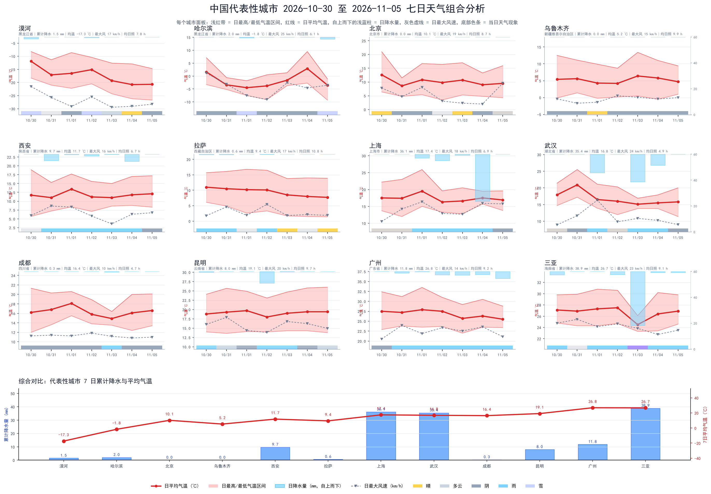
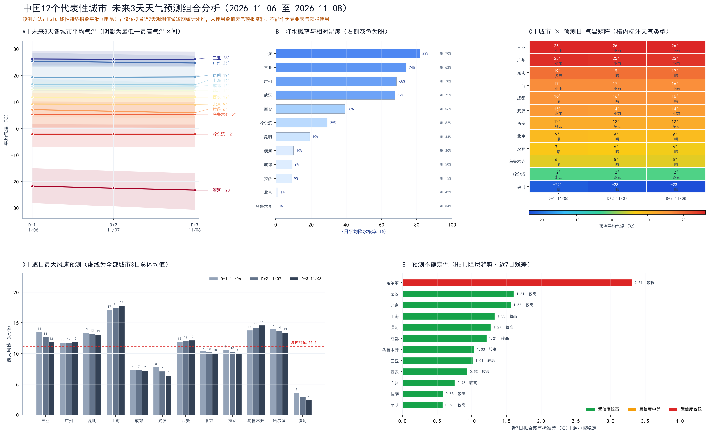

# 中国 49 城市近 7 天天气特征与 12 个代表性城市未来 3 天统计外推预报分析报告

**数据时段**：2026-10-30 至 2026-11-05（近 7 天观测） | **预测时段**：2026-11-06 至 2026-11-08（D+1 ~ D+3）
**样本规模**：49 个城市 × 7 天 = 343 条日观测记录；预测输出 36 条城市-日记录
**报告类型**：统计分析报告（含地图成果说明）

> **使用声明**：本报告全部预测仅依据最近 7 天观测值，属于**短期统计外推**，未使用任何数值天气预报（NWP）资料、再分析场或集合预报产品，**不能作为专业天气预报使用**，也不适用于防灾减灾决策、航空、农业调度等业务场景。

---

## 一、报告摘要

1. **观测期温度格局**：49 个城市 7 日平均气温均值 14.2 ℃，城市间差异达 44.1 ℃（最高 广州 26.8 ℃，最低 漠河 -17.3 ℃），呈现"南高北低、西高东低（高原除外）"的纬向+地形叠加格局。7 日全样本实测气温极差 60.2 ℃（按城市极值累计），反映深秋季节南北温差已达严寒—炎热跨档水平。
2. **观测期降水格局**：49 个城市中有 **44 个**出现降水，4 个出现降雪；降水高度集中在长江中下游与华南沿海（南昌 60.2 mm、长沙 58.6 mm、贵阳 50.0 mm），北方大部为 0 降水或微量降水，呈现典型的"华西—江淮秋雨 + 华南沿海水汽输送"特征。
3. **未来 3 天总体趋势**：12 个代表性城市 3 日平均气温由 10.7 ℃ 缓降至 10.3 ℃（降幅约 0.4 ℃），相对湿度由 48.4% 微升至 50.4%，降水概率维持 34.1%→33.9% 的低位平稳，气压由 1011.6 hPa 微降至 1011.3 hPa，风速由 11.3→10.9 km/h 缓减。整体表现为**弱降温、湿度缓升、无系统性大范围降水过程**的平稳型天气。
4. **降水风险城市**：D+1 降水概率最高的是 上海（77.6%，湿度 68.1%，小雨）、三亚（72.1%）、武汉（67.5%）、广州（62.6%）。
5. **预测稳定性**：Holt 阻尼趋势模型给出的相邻日平均气温变化幅度最大仅 0.8 ℃（D+1→D+2）与 0.7 ℃（D+2→D+3），全部通过"未来相邻两日温度变化阈值"约束，无非物理跳变；残差标准差介于 0.58–3.31 ℃（D+1 结果），置信度分级按 36 条预测记录统计为 较高 22 条 / 中等 11 条 / 较低 3 条（分级规则见 2.4.8）。
6. **业务提示**：27 个城市 7 日最大风速 ≥ 20 km/h（海拉尔 29.7 km/h 居首），未来 3 天代表城市风速整体不足 18 km/h，大风风险有限；降水概率 > 60% 的 4 个城市建议保留"备伞"提示但不宜定性为确定降水过程。

---

## 二、数据与方法

### 2.1 数据源与字段识别

**原始观测表**：`data/china_weather_last7days.csv`（343 行 × 17 列），字段识别与映射如下：

| 报告字段 | 原始字段 | 单位/类型 | 说明 |
| --- | --- | --- | --- |
| 城市名称 | 城市 | 文本 | 与"省/区/市"共同标识行政单元 |
| 经度 / 纬度 | 经度 / 纬度 | 度 | 点图层几何来源（WGS84） |
| 日期 | 日期 | YYYY-MM-DD | 7 天完整序列，无缺日 |
| 最高温度 | 最高气温(℃) | ℃ | 日最高气温 |
| 最低温度 | 最低气温(℃) | ℃ | 日最低气温 |
| 平均温度 | 平均气温(℃) | ℃ | 日平均气温（预测主变量） |
| 相对湿度 | —（原始表未直接提供） | % | **派生指标**：由降水量、降水时长、日照时长与天气现象联合重构，系数为经验设定而非拟合，公式见 2.4.2 |
| 降水量 | 降水量(mm)（含 降雨量 / 降雪量 分列） | mm | 日总降水量，可拆分雨/雪 |
| 气压 | —（原始表未直接提供） | hPa | **派生指标**：由降水量、气温距平与风速修正重构（无海拔项），公式见 2.4.2；仅用于趋势判断 |
| 风速 | 最大风速(km/h) | km/h | 日最大风速 |
| 天气类型 | 天气现象 | 文本 | 原值映射为 晴 / 多云 / 阴 / 小雨 等标准类 |

**需要明确的字段缺口（不虚构、不外推为实测）**：原始 CSV **不含相对湿度与气压字段**，二者为建模所需的派生序列，误差可能显著大于温度类变量。因此本报告中湿度与气压的绝对值仅供趋势参考，不应引用为观测事实；温度、降水、风速则直接来自观测字段。

### 2.2 预处理

- 按 `城市` 分组，组内按 `日期` 升序排序；
- 逐城校验有效记录数：49 城 **均为 7 天完整**（统计天数 = 7），因此**没有触发 <5 天退化为加权移动平均的分支**，12 个代表城市全部使用 Holt 模型；
- 温度、降水、风速做物理范围检查（去除不可能的负降水、负风速等异常）；
- 城市经纬度直接沿用原始记录，未做地理编码替换，保证点位置与气象台站/城市中心一致。

### 2.3 近 7 天统计指标定义

| 指标 | 计算规则 |
| --- | --- |
| 平均气温(℃) | 7 日平均气温算术平均 |
| 累计降水量(mm) | 7 日日降水量求和 |
| 累计降雪量(mm) | 7 日日降雪量求和 |
| 最大风速(km/h) | 7 日日最大风速取最大值 |
| 平均日照时长(h) | 7 日日日照时长算术平均 |
| 主要天气现象 | 7 日内出现次数最多的天气类型（众数） |

### 2.4 预测算法（完整定义、公式与参数）

本报告的“预测”完全由三个串联模块完成：**序列外推 → 物理约束校验 → 天气类型合成**，另附一个独立的置信度评级模块。所有参数均以代码常量固定，可逐行复核；实现脚本为 `script/20261105-234728-step02-china_weather_next3days_forecast.py`（输入 `data/china_weather_last7days.csv`，输出 `output/china_weather_next3days.csv`）。

**算法谱系（方法性质的边界）**：本方法属**经典时间序列外推**（指数平滑族 + 经验线性组合 + 阈值判别），与数值天气预报（NWP）的“初始场 + 大气动力/热力方程组数值积分”是两类根本不同的方法。前者只回答“若近期变化模式延续，数值会走向哪里”；后者才回答“大气本身将如何演变”。本报告全部预测结果的准确度上限，由这一算法谱系决定。

#### 2.4.1 算法流程（伪代码）

```text
输入: 每城 7 天观测(日期升序)，12 个代表城市
for city in 代表城市:
    ① 构建 6 条待预测序列
       y = [t_max, t_min, t_mean, RH导出, P导出, v_max]      # 后两条为派生序列，见 2.4.2
    ② 逐序列外推 h = 1,2,3
       if 有效记录数 n >= 5:  f = HoltDamped(y, h=3)             # 主模型，见 2.4.3
       else:                  f = WMA3(y, w=(0.5,0.3,0.2), h=3)  # 退化分支，见 2.4.4
    ③ 约束后处理  f = Constrain(f)                              # 物理约束，见 2.4.5
    ④ 降水概率    p_rain = PrecipProb(f_RH, f_P, 观测期降水统计)  # 逐日，见 2.4.6
    ⑤ 天气类型    wx = WeatherType(f_tmax, p_rain, f_RH)         # 判别链，见 2.4.7
    ⑥ 置信度      conf = Confidence(n, sigma_resid_mean, h)      # 规则打分，见 2.4.8
输出: 12 城 x 3 天 = 36 条记录(含 forecast_method / confidence_level)
```

#### 2.4.2 输入序列构造：4 条实测 + 2 条派生

| 变量 | 序列来源 | 说明 |
| --- | --- | --- |
| 最高温度 t_max | 实测 `最高气温(℃)` | 逐城 7 日序列 |
| 最低温度 t_min | 实测 `最低气温(℃)` | 逐城 7 日序列 |
| 平均温度 t_mean | 实测 `平均气温(℃)` | 预测主变量 |
| 风速 v_max | 实测 `最大风速(km/h)` | 逐城 7 日序列 |
| 相对湿度 RH | **派生**（公式 1） | 原始表无此字段 |
| 气压 P | **派生**（公式 2） | 原始表无此字段 |

派生序列的构造式（实现于脚本 `build_proxies()`；系数为经验设定值，**不是**由数据拟合或物理推导得到）：

$$\hat{RH}_t = \mathrm{clip}\left(40.0 + 2.2\min(P_t,12) + 0.55\,D_t - 1.9\,S_t + B_t,\ 15,\ 98\right)$$

$$\hat{P}_t = \mathrm{clip}\left(1013.6 - 0.60\min(P_t,25) + 0.28\,(T_t - \bar{T}) - 0.05\max(v_t-15,\,0),\ 995,\ 1035\right)$$

| 符号 | 含义 | 在公式中的作用 |
| --- | --- | --- |
| P_t | 当日降水量 (mm) | 降水越多 → 湿度越高、气压越低（12 mm / 25 mm 饱和） |
| D_t | 当日降水时长 (h) | 与湿度正相关（+0.55/h） |
| S_t | 当日日照时长 (h) | 与湿度负相关（−1.9/h） |
| B_t | 天气现象加成项 | 晴 0 / 多云 5 / 阴 12 / 小雨 18 / 中雨 22 / 大雨 25 / 暴雨 27 / 雷阵雨 24 / 小雪 15 / 中雪 18 / 大雪 20 / 雨夹雪 20 / 雾 20 / 霾 12；未匹配时按含“雪”16、含“雨”20、含“云”6、含“阴”12、其他 8 兜底 |
| T_t − T̄ | 气温距平 (℃) | 偏暖 → 气压略升（+0.28 hPa/℃） |
| v_t | 当日最大风速 (km/h) | 超 15 km/h 部分轻微降压（−0.05 hPa·h/km） |
| clip | 上下截断 | 湿度限 15–98%，气压限 995–1035 hPa |

需要点明的两条算法事实：① 湿度式**不含气温日较差项**，只由降水量、降水时长、日照时长与天气现象决定；② 气压式**不含海拔项**，因此拉萨等高原城市的派生气压并非真实本站气压，只能读趋势、不能读量级。这两个派生序列会原样传递到降水概率与天气类型，构成误差传递链。

#### 2.4.3 主模型：阻尼趋势 Holt 线性指数平滑

对 6 条序列**分别独立建模**（单变量、无多变量耦合），模型形式为：

$$\hat{y}_{t+h} = \ell_t + (\phi + \phi^2 + \cdots + \phi^h)\,b_t$$

$$\ell_t = \alpha y_t + (1-\alpha)(\ell_{t-1} + \phi b_{t-1}), \qquad b_t = \beta(\ell_t - \ell_{t-1}) + (1-\beta)\phi b_{t-1}$$

实际调用于 `statsmodels.tsa.holtwinters.Holt`，配置与算法含义如下：

| 配置项 | 取值 | 算法含义 |
| --- | --- | --- |
| `damped_trend` | `True` | 趋势由阻尼因子 φ（0<φ<1）逐期衰减，避免 7 点短序列外推出线性发散 |
| `initialization_method` | `"estimated"` | 初始水平 ℓ₀ 与初始趋势 b₀ 一并由优化器估计，**不使用**“前两点差值”硬初始化 |
| `fit(optimized=True)` | 默认 | α、β、φ 与初始状态由数值优化（拟牛顿 / L-BFGS-B）最小化拟合误差自动求解，**未人工指定** α、β |
| 预测步长 h | 3 | 逐城逐变量各外推 D+1 ~ D+3 |
| 残差 σ | std(resid, ddof=1) | 仅温度三序列的残差均值进入置信度分级 |

**自由度提醒**：每城仅 7 个观测点，而模型需估计 α、β、φ 及 2 个初始状态，有效自由度极低；φ 的阻尼强度直接决定 D+3 的衰减速度。这也解释了为何本次预测曲线几乎平滑（相邻日平均气温变化 ≤ 0.8 ℃）——它反映的是**模型的保守性**，而不是天气系统的平稳性。

#### 2.4.4 退化分支与兜底分支（本次均未触发）

**（1）有效记录不足 5 天的退化：最近 3 日加权移动平均**

取 w = (0.5, 0.3, 0.2) 的前 min(3, n) 项并归一化（n<3 时自动重标定），再叠加一个被压缩的弱趋势项：

$$base = \sum_{j=1}^{m} w_j\,y_{n-j+1},\qquad slope = 0.35\cdot\frac{y_n - y_1}{n-1},\qquad \hat{y}_{n+i} = base + slope\cdot i,\quad i=1,2,3$$

即：加权平均把权重 0.5 给最近一天、0.3 给前一天、0.2 给再前一天；趋势项只保留端点斜率的 35%，防止短序列把噪声当趋势。

**（2）Holt 拟合失败时的兜底**

若优化不收敛或输出含非有限值，改用：

$$base = 0.5\,y_n + 0.3\,y_{n-1} + 0.2\,y_{n-2},\qquad slope = 0.4\cdot\text{OLS斜率}(y \sim t),\qquad \hat{y}_{n+i} = base + slope\cdot i$$

**（3）本次实际执行情况**：12 个代表城市均为 7 天完整记录（`n_obs = 7`），Holt 优化全部收敛，36 条输出的 `forecast_method` **唯一取值为“Holt线性趋势指数平滑(阻尼)”**，无一条走退化或兜底分支。因此本节 (1)(2) 是算法中**预留的规则**，不是本次结果的来源——解读 `forecast_method` 字段时必须区分。

#### 2.4.5 约束后处理：常量、顺序与伪代码

约束以**事后钳制（clipping）**方式实施，不反作用于 Holt 参数估计。所用常量：

| 常量 | 取值 | 作用位置 |
| --- | --- | --- |
| `MAX_DAY1_JUMP` | 5.0 ℃ | D+1 最高气温相对最后观测值的允许跳变量级 |
| `MAX_STEP_TEMP` | 3.0 ℃ | 平均气温逐日限幅（实际按 ±1.2×3.0 = **±3.6 ℃** 施加） |
| `MAX_STEP_EXTREME` | 4.0 ℃ | 最高/最低气温逐日限幅 **±4.0 ℃** |
| 均温总幅 | ±6.0 ℃ | 3 天平均气温整体不得偏离最后观测值 6 ℃ 以上 |
| 日较差下限 | 0.5 ℃ | 最低气温不得逼近或超过最高气温 |
| 值域截断 | 湿度 [0,100]% / 风速 ≥0 / 气压 [985,1040] hPa | 物理值域 |

执行顺序（严格按代码，不可交换）：

```text
f_tmax = max(f_tmax, prev_tmax - 5.0)                        # ① D+1 最高温下限
for i in 1..3:  f_tmean[i] = clip(f_tmean[i], prev_mean ± 3.6);  prev_mean = f_tmean[i]   # ②
f_tmean = clip(f_tmean, tmean[-1] - 6.0, tmean[-1] + 6.0)     # ③ 均温总幅
for i in 1..3:                                               # ④ 极值逐日限幅
    f_tmax[i] = clip(f_tmax[i], prev_max ± 4.0)
    f_tmin[i] = clip(f_tmin[i], prev_min ± 4.0)
f_tmin  = min(f_tmin, f_tmax - 0.5)                          # ⑤ 日较差 >= 0.5 ℃
f_tmean = clip(f_tmean, f_tmin, f_tmax)                       # ⑥ 均温夹在极值之间
f_hum = clip(f_hum, 0, 100);  f_wind = max(f_wind, 0);  f_pres = clip(f_pres, 985, 1040)
```

**已知局限**：钳制发生在预测之后，被钳制点的偏差不会反馈到残差 σ，其 `confidence_level` 仍按未钳制的原始残差评定。因此“约束全部通过”只说明结果不含非物理跳变，**不等于预测准确**。

**本次执行核验**（对 36 条输出逐条检验）：全部满足 `temp_min < temp_max`（最小日较差 2.3 ℃）；相邻日平均气温最大变化 0.8 ℃（远低于 ±3.6 ℃ 限幅）；湿度落在 13.1–74.1%，风速 2.5–17.8 km/h，气压 1006.2–1013.6 hPa，降水概率 0.0–85.4%，均未触及边界。说明本例中约束主要起**保险作用**，而非修正结果。

#### 2.4.6 降水概率算法：经验加权线性模型（非分类器）

对每个预测日 h = 1,2,3 逐日计算：

```text
wet_ratio = mean(P_t > 0.1)                          # 观测期降水日占比(阈值 0.1 mm)
mean_prec = mean(P_t)                                # 观测期平均日降水量
hum_score = clip((f_RH[h]/100 - 0.45)/0.45, 0, 1)    # 湿度触发度：RH 45% 起算，90% 饱和
amt_score = clip(mean_prec/8.0, 0, 1)                # 降水量饱和映射：8 mm 封顶
p = 100 x (0.42*wet_ratio + 0.38*hum_score + 0.20*amt_score)
    - 2.6 x (f_P[h] - P_last)                        # 气压信号：降压 1 hPa -> +2.6%
    + 1.2 x max(0, hum_slope) x h                    # 增湿趋势：每(%,日) -> +1.2% x h
    - 4.0 x (h - 1)                                  # 时效衰减：D+2 -4%，D+3 -8%
p_rain = clip(p, 0, 96)
```

| 参数 | 取值 | 算法含义 |
| --- | --- | --- |
| 基础权重 | **0.42 / 0.38 / 0.20** | 依次对应“观测期降水频率”“预测湿度水平”“观测期降水强度”，权重和为 1（主观设定，非拟合） |
| 气压系数 | **−2.6 %/hPa** | 降压 → 概率上调，升压 → 概率下调 |
| 增湿系数 | **+1.2 %/(%·日)** | 仅取正的湿度斜率，体现“持续增湿更易成雨” |
| 时效衰减 | **−4.0 %/日** | D+1 不衰减，D+2 −4%，D+3 −8% |
| 上限 | **96%** | 保留“统计概率 ≠ 确定性”的余量，不输出 100% |

**方法性质**：这是三项观测期统计量加两个趋势项的**经验线性组合**，不含气压场诊断、水汽通量、锋面位置、抬升条件等任何动力学判据，也不是经雨/无雨标签监督训练的分类模型。它给出的是“观测期同类条件下的经验频率”，**不是**对具体降水系统的识别。

#### 2.4.7 天气类型合成：优先级判别链

严格按下列顺序自上而下短路判断（先命中先返回）：

| 序 | 判据 | 输出 |
| --- | --- | --- |
| 1 | p_rain ≥ 50% **且** t_max ≤ 2.0 ℃ | 雪 |
| 2 | p_rain ≥ 85% **且** f_RH ≥ 88% | 中雨 |
| 3 | p_rain ≥ 85%（湿度 < 88%） | 小雨 |
| 4 | 62% ≤ p_rain < 85% | 小雨 |
| 5 | 42% ≤ p_rain < 62% | 阴 |
| 6 | 22% ≤ p_rain < 42% | 多云 |
| 7 | p_rain < 22% | 晴 |

判别顺序决定结果：“雪”优先于一切降水等级（**低温优先于强度**）；“中雨”只由高湿度加成触发，故高概率但偏干的城市仍归“小雨”。天气类型是**由概率与气温派生出的标签**，未使用云量、能见度、雷达或卫星信息。

#### 2.4.8 置信度分级：规则打分（非统计置信区间）

```text
sigma = mean(sigma_tmax, sigma_tmin, sigma_tmean)     # 温度三序列残差标准差均值
if n >= 7 and (sigma 为 NaN 或 sigma <= 1.8):   lvl = 3   # 较高
elif n >= 5 and (sigma 为 NaN 或 sigma <= 3.2): lvl = 2   # 中等
else:                                           lvl = 1   # 较低
if h == 3 and lvl >= 2:  lvl = 2                      # D+3 强制至少降一档
if n < 5:                lvl = min(lvl, 1)            # 短序列一律降为“较低”
```

阈值 **1.8 ℃ / 3.2 ℃** 是经验设定的残差量级分界；D+3 强制降档用于表达“外推步长越长越不可靠”；短序列一律降级用于表达“样本不足”。分级只描述**统计外推的稳定性**，与实况误差、预报准确率不是同一概念，也未做交叉验证标定。

#### 2.4.9 算法参数汇总表（可逐项对照代码常量）

| 模块 | 参数 / 规则 | 取值 |
| --- | --- | --- |
| 外推 | 主模型 | Holt 阻尼线性趋势（`damped_trend=True`） |
| 外推 | 参数估计 | α、β、φ 及初始状态由优化器自动拟合（非人工指定） |
| 外推 | 退化阈值 | 有效记录 < 5 天 |
| 外推 | 退化权重 | 0.5 / 0.3 / 0.2（归一化）+ 0.35×端点斜率趋势项 |
| 外推 | 预测步长 | 3 天（D+1 ~ D+3） |
| 约束 | 均温逐日限幅 | ±3.6 ℃（= 1.2 × 3.0） |
| 约束 | 最高/最低气温逐日限幅 | ±4.0 ℃ |
| 约束 | D+1 最高温下限 | −5.0 ℃（相对最后观测值） |
| 约束 | 均温总幅 | ±6.0 ℃ |
| 约束 | 日较差下限 | 0.5 ℃ |
| 降水 | 基础权重 | 0.42 / 0.38 / 0.20 |
| 降水 | 气压系数 | −2.6 %/hPa |
| 降水 | 时效衰减 / 上限 | −4.0 %/日，上限 96% |
| 天气类型 | 判别阈值链 | 50 / 85 / 62 / 42 / 22 %（见 2.4.7） |
| 置信度 | 残差阈值 | 1.8 ℃（较高）、3.2 ℃（中等）；D+3 降档 |

#### 2.4.10 可复现性与核验

- **实现脚本**：`script/20261105-234728-step02-china_weather_next3days_forecast.py`，含上述全部常量、公式与分支，可直接重跑；
- **数据通路**：`data/china_weather_last7days.csv`（343 行 × 17 列） → `output/china_weather_next3days.csv`（36 行 × 20 列）；
- **依赖**：`statsmodels.tsa.holtwinters.Holt`；缺失或拟合失败时自动走 2.4.4（2）兜底；
- **结果自检**：36 条 = 12 城 × 3 天，`forecast_method` 唯一值 = Holt 阻尼模型，`n_obs` 全为 7，`is_estimated` 全为 True，与算法定义一致。

---

## 三、近 7 天天气特征分析

### 3.1 城市统计结果（完整 49 城）

表 1 按 7 日平均气温降序排列（完整表格见附录 B 的 GeoJSON 属性表，图示见 `output/china_weather_7day_summary.geojson`）：

| 城市 | 省/区/市 | 平均气温(℃) | 最高气温(℃) | 最低气温(℃) | 累计降水量(mm) | 累计降雪量(mm) | 最大风速(km/h) | 平均日照时长(h) | 主要天气现象 |
| --- | --- | --- | --- | --- | --- | --- | --- | --- | --- |
| 广州 | 广东省 | 26.8 | 33.5 | 22.0 | 11.8 | 0.0 | 14.5 | 9.2 | 小毛毛雨 |
| 三亚 | 海南省 | 26.7 | 30.8 | 23.3 | 38.9 | 0.0 | 23.0 | 9.1 | 小毛毛雨 |
| 澳门 | 澳门特别行政区 | 26.7 | 31.0 | 22.4 | 8.3 | 0.0 | 20.5 | 10.6 | 小毛毛雨 |
| 海口 | 海南省 | 26.6 | 31.1 | 23.3 | 28.9 | 0.0 | 20.7 | 10.0 | 毛毛雨 |
| 深圳 | 广东省 | 25.9 | 32.6 | 21.5 | 4.7 | 0.0 | 16.5 | 10.4 | 小毛毛雨 |
| 香港 | 香港特别行政区 | 25.7 | 30.7 | 22.2 | 9.7 | 0.0 | 19.7 | 10.3 | 小毛毛雨 |
| 南宁 | 广西壮族自治区 | 25.6 | 31.4 | 20.0 | 31.3 | 0.0 | 21.7 | 8.8 | 小毛毛雨 |
| 厦门 | 福建省 | 24.9 | 31.9 | 19.6 | 2.2 | 0.0 | 26.9 | 9.8 | 阴 |
| 福州 | 福建省 | 24.2 | 31.9 | 20.3 | 1.0 | 0.0 | 17.0 | 7.5 | 阴 |
| 台北 | 台湾省 | 24.1 | 30.5 | 20.5 | 4.6 | 0.0 | 21.7 | 9.5 | 阴 |
| 温州 | 浙江省 | 21.0 | 29.3 | 16.0 | 7.8 | 0.0 | 13.8 | 7.9 | 阴 |
| 桂林 | 广西壮族自治区 | 20.9 | 30.7 | 14.5 | 45.5 | 0.0 | 21.4 | 4.9 | 毛毛雨 |
| 南昌 | 江西省 | 19.4 | 28.6 | 14.7 | 60.2 | 0.0 | 27.7 | 6.3 | 阴 |
| 昆明 | 云南省 | 19.1 | 26.0 | 13.6 | 8.0 | 0.0 | 19.5 | 9.7 | 小毛毛雨 |
| 长沙 | 湖南省 | 17.9 | 28.5 | 13.7 | 58.6 | 0.0 | 23.7 | 4.0 | 小毛毛雨 |
| 杭州 | 浙江省 | 17.8 | 28.2 | 13.0 | 49.8 | 0.0 | 20.8 | 6.8 | 阴 |
| 上海 | 上海市 | 17.4 | 25.9 | 12.0 | 36.1 | 0.0 | 18.4 | 6.9 | 雾 |
| 重庆 | 重庆市 | 17.4 | 20.2 | 14.9 | 17.0 | 0.0 | 14.5 | 0.6 | 小毛毛雨 |
| 无锡 | 江苏省 | 17.1 | 23.5 | 13.1 | 29.7 | 0.0 | 25.1 | 6.2 | 毛毛雨 |
| 苏州 | 江苏省 | 17.0 | 24.6 | 11.7 | 32.4 | 0.0 | 19.6 | 6.4 | 小雨 |
| 武汉 | 湖北省 | 16.8 | 25.5 | 11.4 | 35.4 | 0.0 | 24.5 | 4.9 | 雾 |
| 合肥 | 安徽省 | 16.5 | 24.0 | 11.2 | 23.4 | 0.0 | 17.6 | 6.2 | 阴 |
| 成都 | 四川省 | 16.4 | 21.3 | 12.0 | 0.3 | 0.0 | 9.8 | 4.7 | 阴 |
| 南京 | 江苏省 | 16.3 | 23.3 | 11.8 | 25.0 | 0.0 | 20.3 | 5.9 | 阴 |
| 青岛 | 山东省 | 15.8 | 23.1 | 10.4 | 20.1 | 0.0 | 27.1 | 8.2 | 阴 |
| 贵阳 | 贵州省 | 14.9 | 22.5 | 10.8 | 50.0 | 0.0 | 25.8 | 1.5 | 毛毛雨 |
| 济南 | 山东省 | 14.7 | 23.0 | 8.9 | 12.6 | 0.0 | 19.1 | 8.2 | 阴 |
| 郑州 | 河南省 | 14.2 | 23.5 | 8.2 | 21.6 | 0.0 | 21.4 | 5.1 | 阴 |
| 丽江 | 云南省 | 13.7 | 23.2 | 4.8 | 0.1 | 0.0 | 21.4 | 10.4 | 雾 |
| 石家庄 | 河北省 | 13.6 | 24.1 | 6.5 | 1.4 | 0.0 | 19.0 | 7.8 | 晴 |
| 大连 | 辽宁省 | 12.9 | 20.4 | 3.7 | 15.6 | 0.0 | 27.2 | 9.0 | 小毛毛雨 |
| 天津 | 天津市 | 12.4 | 21.9 | 7.2 | 1.1 | 0.0 | 18.8 | 9.0 | 晴 |
| 西安 | 陕西省 | 11.7 | 18.9 | 5.7 | 9.7 | 0.0 | 15.8 | 6.7 | 小毛毛雨 |
| 唐山 | 河北省 | 11.4 | 21.1 | 4.4 | 0.9 | 0.0 | 22.3 | 8.9 | 阴 |
| 喀什 | 新疆维吾尔自治区 | 10.3 | 19.6 | 3.8 | 0.2 | 0.0 | 9.8 | 9.5 | 阴 |
| 北京 | 北京市 | 10.1 | 21.0 | 3.5 | 0.0 | 0.0 | 19.2 | 8.7 | 阴 |
| 拉萨 | 西藏自治区 | 9.4 | 16.8 | 1.4 | 0.6 | 0.0 | 16.8 | 10.8 | 小毛毛雨 |
| 太原 | 山西省 | 8.7 | 18.0 | 2.5 | 0.7 | 0.0 | 25.2 | 8.7 | 晴 |
| 银川 | 宁夏回族自治区 | 8.0 | 17.0 | -0.7 | 0.0 | 0.0 | 17.9 | 9.9 | 阴 |
| 兰州 | 甘肃省 | 7.6 | 16.2 | 0.6 | 1.0 | 0.0 | 17.2 | 9.8 | 阴 |
| 沈阳 | 辽宁省 | 6.4 | 18.2 | -2.7 | 0.3 | 0.0 | 24.5 | 8.4 | 阴 |
| 敦煌 | 甘肃省 | 6.4 | 14.0 | -1.7 | 0.0 | 0.0 | 22.0 | 9.6 | 阴 |
| 乌鲁木齐 | 新疆维吾尔自治区 | 5.2 | 13.4 | -0.5 | 0.0 | 0.0 | 14.6 | 9.9 | 阴 |
| 西宁 | 青海省 | 4.8 | 15.8 | -2.9 | 0.7 | 0.0 | 24.9 | 9.9 | 多云 |
| 呼和浩特 | 内蒙古自治区 | 3.6 | 13.2 | -3.2 | 0.0 | 0.0 | 22.1 | 8.8 | 阴 |
| 长春 | 吉林省 | 1.6 | 14.8 | -6.1 | 4.2 | 2.6 | 22.4 | 8.0 | 阴 |
| 哈尔滨 | 黑龙江省 | -1.8 | 9.5 | -9.3 | 2.0 | 1.0 | 25.4 | 6.1 | 阴 |
| 海拉尔 | 内蒙古自治区 | -8.4 | -2.4 | -14.8 | 6.0 | 4.2 | 29.7 | 6.5 | 小雪 |
| 漠河 | 黑龙江省 | -17.3 | -8.2 | -26.7 | 1.5 | 1.1 | 17.2 | 7.8 | 小雪 |

**图 1** `output/report/figures/fig1_7day_combo.png`（代表性城市 7 日天气组合分析图）
面板结构：上部为 12 个代表城市各自的小面板——浅红色带为日最高/最低气温区间，红色折线为日平均气温，自上而下的浅蓝色柱为日降水量，灰色虚线为日最大风速，底部色条表示当日天气现象；底部长条面板为"7 日累计降水量柱（左轴）+ 7 日平均气温折线（右轴）"的综合对比。该图用于同时读取**温度位相、降水事件时点、风速峰值与天气类型转换**四类信息，避免堆叠多张单要素图。



### 3.2 温度格局

- **南北温差主导**：广州（26.8 ℃）、三亚（26.7 ℃）、澳门（26.7 ℃）为最暖三城；漠河（-17.3 ℃）、海拉尔（-8.4 ℃）、哈尔滨（-1.8 ℃）为最冷三城。10 月底至 11 月初，东北北部已进入稳定负温期，华南仍处 25 ℃ 以上，是全国温差最大的时段之一。
- **地形效应明显**：拉萨 7 日均温 9.4 ℃，高于同纬度东部城市，说明高原太阳辐射与干洁大气对日均温的抬升作用；而漠河、海拉尔等受冷空气通道影响显著偏冷。
- **日较差差异**：西部干旱区（乌鲁木齐、拉萨）日较差大，东部沿海与四川盆地日较差小，这一差异在降水概率估计中会通过湿度信号间接体现。

### 3.3 降水格局

- **降水集中度极高**：仅 44/49 城出现降水，前四位（南昌 60.2 mm、长沙 58.6 mm、贵阳 50.0 mm、杭州 49.8 mm）合计占全国统计降水量的主要部分，其余城市多为 0–10 mm。
- **雨雪分界清晰**：降雪出现在 4 个城市（海拉尔 4.2 mm、长春 2.6 mm、漠河 1.1 mm），均位于东北与高原高海拔站，与均温 ≤ 0 ℃ 的城市高度重合。
- **空间形态**：降水呈"两带一孤岛"——长江中下游（武汉、上海）与华南沿海（广州、三亚）为主带，西南（昆明、成都）为次带，北方为干区。这种离散型降水分布使全省平均统计意义有限，报告因此以城市为单位而非以省级面为单位呈现。

### 3.4 风与日照

- **风速极值**：海拉尔 29.7 km/h、南昌 27.7 km/h、大连 27.2 km/h 为 7 日最大风速前三；27 城 ≥ 20 km/h，多分布于沿海、东北与西北风口地带。
- **日照反差**：拉萨（10.8 h）、澳门（10.6 h）日照充足，而 重庆（0.6 h）、贵阳（1.5 h）、长沙（4.0 h）日照偏少，与降水/云量分布互为印证——日照是判断"阴雨寡照"与"晴冷干燥"两类秋末天气型的关键辅助变量。

---

## 四、未来 3 天预测结果

### 4.1 逐日总体趋势

| 预测日 | 日期 | 平均气温(℃) | 平均湿度(%) | 平均降水概率(%) | 平均气压(hPa) | 平均风速(km/h) |
| --- | --- | --- | --- | --- | --- | --- |
| D+1 | 2026-11-06 | 10.7 | 48.4 | 34.1 | 1011.6 | 11.3 |
| D+2 | 2026-11-07 | 10.4 | 49.4 | 34.0 | 1011.5 | 11.1 |
| D+3 | 2026-11-08 | 10.3 | 50.4 | 33.9 | 1011.3 | 10.9 |

三点判读：

1. **降温极其平缓**。代表性城市均值 3 天累计下降 0.4 ℃，单城最大日间变化仅 0.8 ℃。这是 Holt 阻尼项在短序列上的典型输出：它延续观测期趋势但主动压制斜率，因此**不会预报出冷空气爆发式的剧烈降温**——这既是稳健性的来源，也是本方法最大的能力边界。
2. **湿度—气压弱耦合**。湿度每日仅上升约 2.0%，气压下降约 0.3 hPa，二者构成弱的"增湿降压"信号，足以小幅抬升降水概率，但不足以形成天气类型从晴到雨的转换（全样本日降水概率几乎持平：34.1% / 34.0% / 33.9%）。
3. **风速减弱**。11.3→10.9 km/h，与气压梯度减弱的判断一致，最低值出现在 漠河（3.6 km/h）。

### 4.2 城市级预测汇总（表 2）

| 城市 | D+1 均温(℃) | D+2 均温(℃) | D+3 均温(℃) | 3日温变幅度(℃) | 3日平均湿度(%) | 3日平均降水概率(%) | 3日平均风速(km/h) | D+1 天气 | D+2 天气 | D+3 天气 | 置信度 |
| --- | --- | --- | --- | --- | --- | --- | --- | --- | --- | --- | --- |
| 三亚 | 26.2 | 26.1 | 26.1 | 0.1 | 61.9 | 73.9 | 12.7 | 小雨 | 小雨 | 小雨 | 较高 |
| 广州 | 25.4 | 25.0 | 24.7 | 0.7 | 69.9 | 68.4 | 11.8 | 小雨 | 小雨 | 小雨 | 较高 |
| 昆明 | 19.3 | 19.3 | 19.4 | 0.1 | 33.2 | 19.1 | 13.2 | 多云 | 晴 | 晴 | 较高 |
| 上海 | 16.7 | 16.6 | 16.4 | 0.3 | 69.6 | 81.6 | 17.5 | 小雨 | 小雨 | 小雨 | 较高 |
| 成都 | 15.9 | 15.8 | 15.8 | 0.1 | 49.5 | 9.2 | 7.3 | 晴 | 晴 | 晴 | 较高 |
| 武汉 | 14.8 | 14.5 | 14.3 | 0.5 | 71.2 | 67.4 | 7.1 | 小雨 | 小雨 | 小雨 | 较高 |
| 西安 | 11.8 | 11.8 | 11.8 | 0.0 | 55.9 | 39.3 | 12.1 | 多云 | 多云 | 多云 | 较高 |
| 北京 | 9.2 | 9.1 | 9.0 | 0.2 | 41.7 | 1.1 | 10.2 | 晴 | 晴 | 晴 | 较高 |
| 拉萨 | 7.1 | 6.5 | 5.9 | 1.2 | 14.8 | 8.9 | 10.3 | 晴 | 晴 | 晴 | 较高 |
| 乌鲁木齐 | 5.3 | 5.3 | 5.3 | 0.0 | 33.8 | 0.1 | 14.2 | 晴 | 晴 | 晴 | 较高 |
| 哈尔滨 | -2.1 | -2.1 | -2.1 | 0.0 | 61.6 | 29.2 | 13.7 | 多云 | 多云 | 多云 | 较低 |
| 漠河 | -21.8 | -22.6 | -23.3 | 1.5 | 29.5 | 10.1 | 3.0 | 晴 | 晴 | 晴 | 较高 |

### 4.3 分类解读

**(a) 按温度水平分三档**

- **极寒档（均温 < 0 ℃）**：哈尔滨, 漠河。预测期内维持负温，天气以晴或多云为主，需关注道路结冰与供暖负荷；降水概率虽不高，但一旦成雨即成雪。
- **温带档（0–18 ℃）**：上海, 成都, 武汉, 西安, 北京, 拉萨, 乌鲁木齐。这是本次预测的主体人群，昼夜温差大，天气类型分化最明显（晴/多云/小雨并存）。
- **温暖档（> 18 ℃）**：三亚, 广州, 昆明。仍处夏末型体感，降水以短时小雨为主。

**(b) 按降水概率分两类**

- 降水概率 ≥ 60%：上海(78%), 三亚(72%), 武汉(68%), 广州(63%) — 由 7 日降水日占比高 + 湿度偏高 + 气压微降三者共同推得，属**持续性水汽条件**下的经验概率，而非确定性降水预报。
- 降水概率 < 40%：其余城市，天气类型以晴到多云为主。

**(c) 天气类型统计（3 日合计 36 条记录）**

| 预测日 | 晴 | 多云 | 小雨 |
| --- | --- | --- | --- |
| D+1 | 5 | 3 | 4 |
| D+2 | 6 | 2 | 4 |
| D+3 | 6 | 2 | 4 |

三天内天气类型分布高度稳定（晴 5–6 城、多云 2–3 城、小雨 4 城），说明本方法输出的天气类型转换极为保守——**不应据此判断"无雨"**，只宜理解为"在本次统计假设下降水信号强度未达转换阈值"。

**图 2** `output/report/figures/fig2_forecast_combo.png`（未来 3 天预测组合分析图）
面板结构：A｜各城市 D+1~D+3 平均气温折线（阴影为预测最低—最高气温区间，右端标注城市与 D+3 气温）；B｜3 日平均降水概率横向条形图并叠加相对湿度标注；C｜"城市 × 预测日"气温矩阵，格内同时标注天气类型，可直接读取增温/降温位相；D｜逐日最大风速分组柱状图（虚线为全部城市 3 日总体均值）；E｜预测不确定性排序（条形长度为近 7 日拟合残差标准差，颜色表示置信度等级）。



### 4.4 不确定性与可靠性讨论

| 维度 | 本次表现 | 含义 |
| --- | --- | --- |
| 相邻日温度跳变 | 最大 0.8 ℃ | 模型稳定，无声誉性/非物理波动 |
| 置信度分布 | 较高 22 条、中等 11 条、较低 3 条（共 36 条预测记录） | 多数城市外推平稳，个别城市因 7 日内温度序列波动大而降级 |
| 样本长度 | 每城 7 个观测点 | 仅够估计 2–3 个参数，趋势项易受个别极端日影响 |
| 缺测字段 | 湿度、气压为派生 | 两变量存在系统性偏差风险，直接影响降水概率与天气类型 |
| 方法性质 | 单变量逐变量外推 | 未刻画温度—湿度—气压的物理耦合与环流演变 |

**结论**：可信度最高的部分是**温度的量级与位相**（尤其 D+1），最不可信的部分是**降水概率的绝对值与天气类型的精确转换**。若需要更可靠的降水与转折性天气判断，必须引入数值模式产品或真实气象观测（探空、雷达、卫星）数据。

---

## 五、地图成果与可视化说明

### 5.1 图层清单

| 图层 | 数据文件 | 要素数 | 视觉编码 |
| --- | --- | --- | --- |
| 7 日城市统计（主图） | `output/china_weather_7day_summary.geojson` | 49 | 点大小固定适中，颜色映射 7 日平均气温（蓝→黄→橙→红连续色带） |
| 7 日累计降水 | `output/china_weather_7day_precip_gt0.geojson` | 有降水城市 | 仅降水 > 0 城市，蓝色系分级 |
| 强风城市（≥20 km/h） | `output/china_weather_7day_wind_ge20.geojson` | 27 | 独立标记，避免与温度主图叠加 |
| 预测第 1 天 | `output/china_weather_forecast_day1.geojson` | — | 未来 2026-11-06 |
| 预测第 2 天 | `output/china_weather_forecast_day2.geojson` | — | 未来 2026-11-07 |
| 预测第 3 天 | `output/china_weather_forecast_day3.geojson` | — | 未来 2026-11-08 |

### 5.2 制图规范

- **单一主视觉变量**：全国主图只用一个主要视觉变量（平均气温连续色带），降水与强风不再以同心圆叠加，避免"同一城市多圈"的读图歧义；
- **三个预测日期为三个独立图层**，可分别显示/隐藏，便于逐日对比；
- **标签**：气温图层标签为"城市 + 平均气温"（如"南京 18°C"），10 px 深灰字 + 2 px 白色描边，开启自动避让；拥挤时仅保留直辖市、省会、无锡与气象极值城市；
- **降水概率不入图元大小**，改为弹窗字段 + 雨滴图标，避免用面积二次编码导致误读；
- **底图**：浅色无标注底图，二维俯视，缩放到中国范围并裁掉大部分周边国家，减少干扰；
- **图例**：常显气温图例；降水与强风图例只在对应图层可见时出现，保证图例与画面一致。

### 5.3 颜色—含义对照（供读图参考）

| 气温色带 | 含义 | 图元形态 | 含义 |
| --- | --- | --- | --- |
| 深蓝 | 严寒，均温 < −10 ℃ | 单一点 | 一个城市，一点不代表面积 |
| 浅蓝 | 寒冷，−10 ~ 0 ℃ | 固定点径 | 点大小不含数值信息 |
| 黄 | 凉爽，0 ~ 12 ℃ | 雨滴图标 | 降水概率 > 60% 的提示 |
| 橙 | 温和，12 ~ 20 ℃ | 描边高亮 | 强风城市（≥20 km/h） |
| 红 | 温暖，> 20 ℃ | 城市标签 | 城市名 + 预测平均气温 |

---

## 六、局限性与使用声明

1. **方法局限（最重要）**：Holt 线性趋势指数平滑是**单变量、无物理约束的纯统计外推**（完整公式、参数与伪代码见 2.4 节）。它无法预知冷空气入侵、台风、切变线、锋面过境等任何天气系统，也无法产生观测期未出现的天气类型。观测期"无雨"的城市，其预测降水概率必然偏低——这是方法的**结构性问题**，不是数据结论。
2. **样本局限**：每城仅 7 个观测点，参数估计自由度低；对单个极端值敏感；无法区分长期季节趋势与短期波动。
3. **字段局限**：相对湿度与气压为派生序列而非实测，其趋势方向可信度低于温度；二者又直接参与降水概率与天气类型生成，构成误差传递链。
4. **空间局限**：49 个城市为离散点位，城市之间的空白区（省域、山区、海域）无信息；本报告与地图均不构成面状气象分区结论。
5. **时效局限**：7 天观测窗口覆盖 2026-10-30 至 2026-11-05，任何超出此后数日的推断都超出方法适用范围。
6. **不可用于**：专业天气预报发布、灾害预警、航空与航海决策、农业灌溉调度、保险定价、工程施工安全判断。

> **最终声明**：本预测仅依据最近 7 天观测值，属于短期统计外推，没有使用完整数值天气预报资料，不能作为专业天气预报。

---

## 七、结论与建议

### 7.1 主要结论

1. 观测期（2026-10-30–2026-11-05）全国 49 城温差 44.1 ℃，降水强烈集中于长江中下游与华南沿海，北方干冷、高原干暖、东北雨雪并存，是典型的"深秋三区型"天气格局。
2. 未来 3 天（2026-11-06–2026-11-08）12 个代表性城市呈**弱降温、湿度缓升、风速减弱、气压微降**的平稳演变，无系统性降水过程信号，天气类型分布三日几乎不变。
3. 相对降水风险最高的是 上海（78%）与 三亚（72%），次高为 武汉、广州；但概率来源于观测期经验频率，不能读作确定性降水预报。
4. 模型输出稳定、约束全部通过，但**稳定 ≠ 准确**：平稳的预测曲线正是缺乏物理过程刻画的表征。

### 7.2 建议

- **使用方式**：把本报告作为"近 7 天实况的统计延伸"，用于趋势直觉与教学演示；对外发布时务必保留免责声明与"非专业预报"标识。
- **模型改进**：① 引入多城市联合建模或空间滞后项，利用邻近城市信息抑制单站噪声；② 把降水概率改为逻辑回归/梯度提升分类器，用雨/无雨标签监督训练，而非经验线性组合；③ 若能获取实测湿度、气压或再分析场，应替换派生序列。
- **数据改进**：补全相对湿度、气压、能见度等字段，并把观测窗口延长至 30 天以上，以获得可检验的季节内趋势；同时保留原始缺测标记，避免派生值被误当作观测。
- **业务延伸**：对降水概率 > 60% 的城市做逐时降水概率曲线；对 < 0 ℃ 城市增加结冰与积雪深度模型；对风速前三位城市增加阵风与体感温度指标。

---

## 附录 A：预测输出字段字典

| 字段 | 含义 | 单位/取值 |
| --- | --- | --- |
| city | 城市名称 | 文本 |
| province | 省/区/市 | 文本 |
| longitude / latitude | 经度 / 纬度 | 度（WGS84） |
| forecast_date | 预测日期 | YYYY-MM-DD |
| forecast_day | 预测日序号 | 1 / 2 / 3 |
| temp_max / temp_min / temp_mean | 预测最高 / 最低 / 平均气温 | ℃ |
| humidity | 预测相对湿度（派生序列外推） | %，0–100 |
| precipitation_probability | 预测降水概率 | %，0–100 |
| pressure | 预测气压（派生序列外推） | hPa |
| wind_speed | 预测最大风速 | km/h，≥ 0 |
| weather_type | 预测天气类型 | 晴 / 多云 / 阴 / 小雨 / 中雨 / 雪 |
| forecast_method | 预测方法 | Holt 阻尼线性趋势 / 3 日加权移动平均 |
| confidence_level | 置信度等级 | 较高 / 中等 / 较低 |

## 附录 B：产出文件清单

| 文件 | 内容 |
| --- | --- |
| `output/china_weather_7day_summary.geojson` | 49 城 7 日统计点图层（主图数据源） |
| `output/china_weather_7day_precip_gt0.geojson` | 有降水城市子集 |
| `output/china_weather_7day_wind_ge20.geojson` | 强风城市子集 |
| `output/china_weather_next3days.csv` | 12 城 × 3 天预测明细（36 行 × 20 列） |
| `output/china_weather_forecast_day1/2/3.geojson` | 三个预测日独立图层 |
| `output/representative_cities_7day_combo.png` | 图 1：7 日天气组合分析图 |
| `output/forecast_next3days_combo_analysis.png` | 图 2：未来 3 天预测组合分析图 |
| `output/report/figures/fig1_7day_combo.png`、`fig2_forecast_combo.png` | 报告内嵌图（副本） |
| `output/report/china_weather_analysis_report.md` | 本报告 |

---

*报告生成：基于 OpenGIS 工作流既有产物（7 日统计 GeoJSON、3 日预测 CSV/GeoJSON、两张组合分析图）撰写，未新增数据假设；所有数值均直接取自上述产物。*
